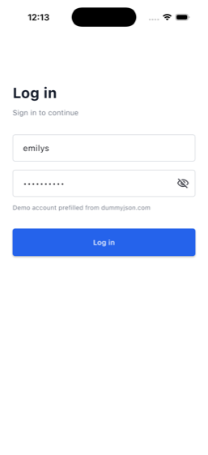
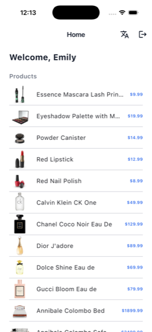
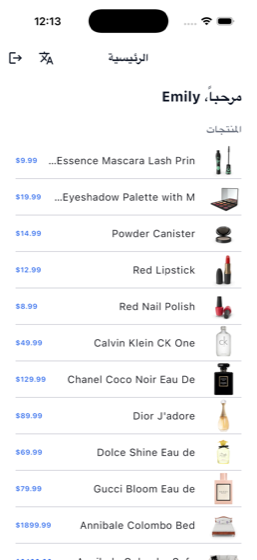

# Flutter GetX Starter

A production-minded Flutter starter built on **GetX**. It gives every project the same foundation: a strict split between UI and logic, one centralized network layer, a persisted user session, route guards, and **Arabic / English localization with RTL** out of the box.

<p align="center">
  
  
  
</p>

## Why this starter

- **Every screen is two files.** `login.dart` draws the UI, `login_controller.dart` holds the logic. They are never mixed, so screens stay easy to read, review and test.
- **One network layer.** All HTTP goes through `Api.makeApiRequest`. It checks connectivity, adds the auth header, applies a timeout, shows a loading dialog (always closed in `finally`), shows a single error dialog on failure, and returns a predictable `{success, message}` map. Controllers never import `http` and never wrap requests in `try/catch`.
- **Localization and RTL are built in.** Arabic and English share the same keys (enforced by a test). Text direction follows the active language, and the choice is persisted.
- **Small, boring, predictable.** Fixed folders, fixed names, one route list. A new developer can find anything in seconds.

## Quick start

Requirements: a recent stable Flutter SDK (Dart 3.14+).

```bash
git clone https://github.com/AdhamAlbanna/flutter-getx-starter.git
cd flutter-getx-starter
flutter pub get
flutter run
```

The app talks to the public [dummyjson.com](https://dummyjson.com) API and prefills a demo account, so you can log in immediately. Point `lib/Network/api_links.dart` at your own backend when you are ready.

Make it yours:

1. Rename the package: change `name:` in `pubspec.yaml` and replace `flutter_getx_starter` in `lib/` and `test/` imports.
2. Set your bundle identifier (iOS) and application ID (Android).
3. Change the primary color in `lib/constants/appcolor.dart`.
4. Add your font under `assets/fonts/`, register it in `pubspec.yaml`, and set `fontFamily` in the `ThemeData` in `lib/main.dart`.

## Project structure

```text
lib/
  main.dart                      App entry: init services, GetMaterialApp
  routes.dart                    The single list of GetPage routes + bindings
  constants/
    appcolor.dart                Colors
    approutes.dart               Route name constants
  localization/
    mylocalization.dart          Arabic + English translations
  model/                         Data classes with fromJson
  Network/
    api_links.dart               Endpoint constants only
    api.dart                     Api.makeApiRequest: the only HTTP code
  helper/
    functions/                   validInput, UserSession, dialogs, connectivity, local storage
    middleware/                  Route guards
    services/                    Long-lived GetxService + initialServices()
    widgets/<group>/             Shared Custom* widgets
  view_controller/
    <screen>/
      <screen>.dart              UI only
      <screen>_controller.dart   Logic only
      items/                     Widgets used by this screen only
test/
```

## How a request flows

```text
Screen (UI)  ──tap──▶  Controller  ──▶  Api.makeApiRequest  ──▶  Server
     ▲                     │                    │
     └──── update() ◀──────┘◀── {success: true, ...} / dialog + {success: false}
```

```dart
Future<void> loadProducts() async {
  final response = await Api.makeApiRequest(
    url: ApiLinks.products,
    method: 'GET',
  );

  if (response['success'] == true) {
    products = (response['products'] as List<dynamic>)
        .map((json) => Product.fromJson(json))
        .toList();
    update();
  }
}
```

If the request fails, `Api` has already shown the error. The controller only handles success.

## Conventions

| Thing | Rule | Example |
|---|---|---|
| Screen folder and file | `snake_case`, same name | `login/login.dart` |
| Controller | `<screen>_controller.dart`, class `<Screen>Controller` | `LoginController` |
| Screen class | PascalCase noun, no `Screen` suffix | `Login` |
| Screen-only widget | ends in `Item`, lives in `items/` | `ProductItem` |
| Shared widget | `Custom` prefix, lives in `helper/widgets/<group>/` | `CustomButton` |
| Route | `AppRoute.camelCase`, string matches the name | `AppRoute.home` = `"/home"` |
| Translation key | English `snake_case` | `welcome_user` |
| Imports | always absolute `package:` imports | |

Rules worth enforcing in code review:

- No API calls, business rules or navigation decisions in UI files.
- No `async` `onInit`. Start loading from a separate `Future` method.
- No hardcoded user-facing strings. Use `'key'.tr`.
- No `print`. Use `debugPrint` behind `kDebugMode`.
- `flutter analyze` and `flutter test` must pass.

## Adding a feature

See [docs/ADDING_A_SCREEN.md](docs/ADDING_A_SCREEN.md) for the step-by-step checklist (screen, controller, route, binding, translations, API call, tests).

## Testing

```bash
flutter analyze
flutter test
```

Included tests cover input validation, model parsing, the user session, and a check that Arabic and English translations define exactly the same keys.

## Notes

- **GetX and `material_ui`:** newer Flutter releases deprecate `package:flutter/material.dart` in favor of `package:material_ui`. GetX 4.x still builds on the former, so this starter uses it too and silences that one lint in `analysis_options.yaml`. Do not mix the two packages in one app. Remove the ignore once GetX migrates.
- **Auth header:** `Api` sends `UserSession.token` as the raw `Authorization` header value. If your backend expects `Bearer <token>`, change it in one place: `lib/Network/api.dart`.
- **Backends without a `success` field:** `Api` derives `success` from the HTTP status code, so plain REST APIs work without changes.

## Contributing

Issues and pull requests are welcome. Keep changes small, follow the conventions above, and run `dart format`, `flutter analyze` and `flutter test` before opening a PR.

## License

[MIT](LICENSE) © Adham Albanna
